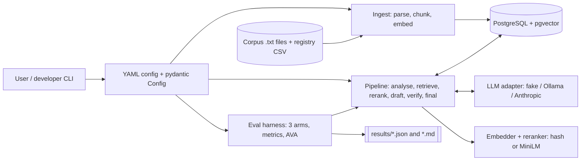
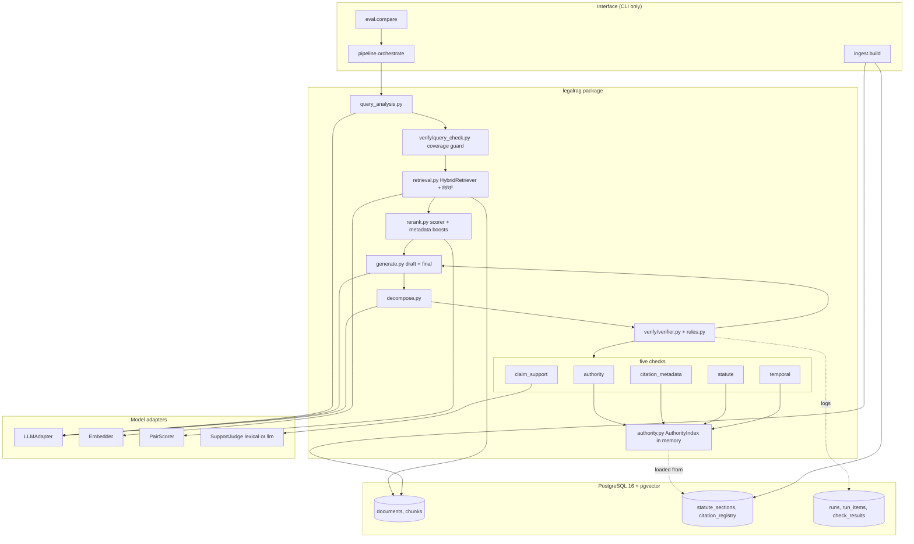
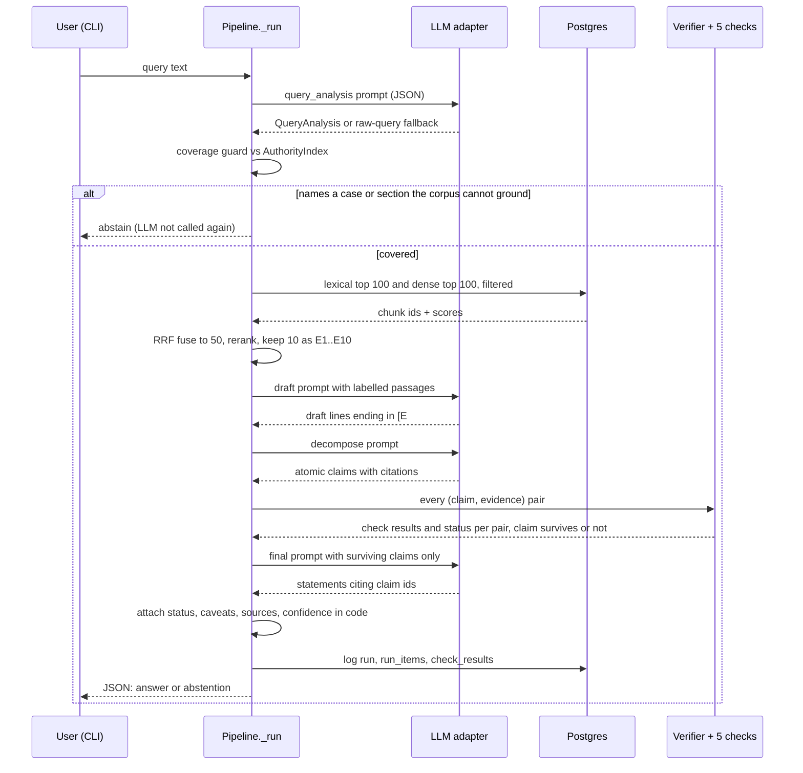
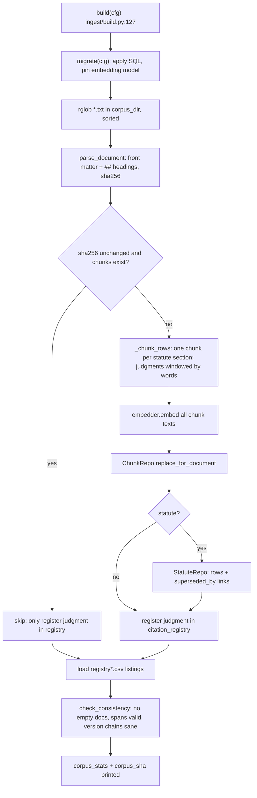
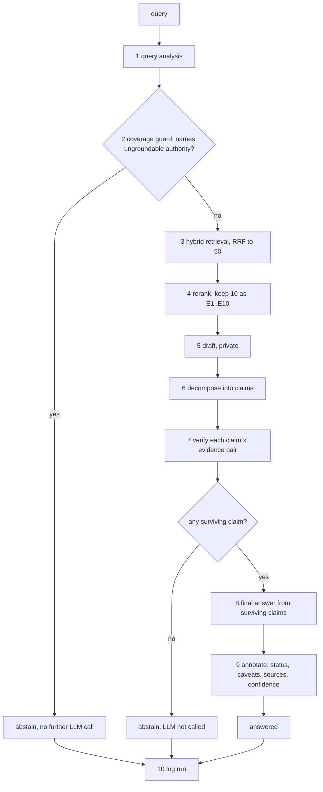
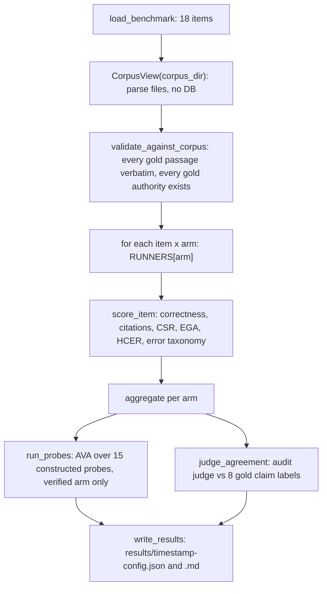
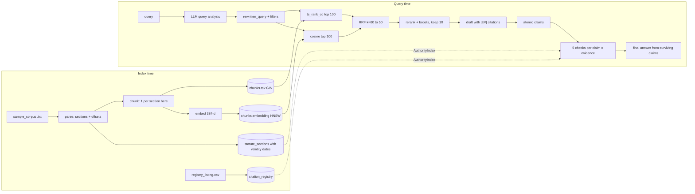
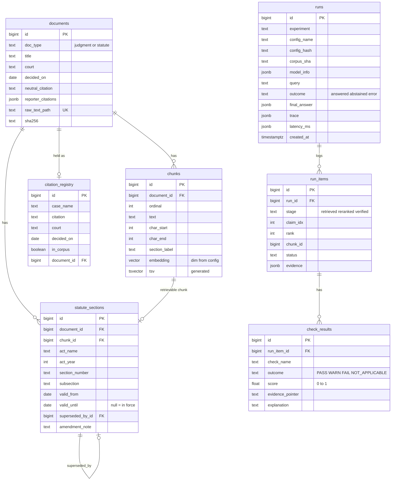

//# COMPLETE REPOSITORY ANALYSIS: `legalrag`

*Confidence-Aware, Source-Grounded Verification of AI-Generated Legal Answers* (B.Tech mini project, BVCOE)

- Repository root analysed: `C:\Users\singh\OneDrive\Desktop\micro` (not a git repository; no commit history exists)
- Analysis date: 2026-09-20
- Source size: ~3,520 lines of Python in `legalrag/` (excluding tests) + ~970 lines of tests
- No project file was modified. Two throwaway Postgres databases were created and dropped by the test suite and one probe script; the project's own `legalrag` database was never touched.

### How to read this report

**Evidence convention.** `file:line` points to the file as it exists on disk today. All paths are relative to the repo root.

**Status tags used throughout**

| Tag | Meaning |
|---|---|
| **[IMPLEMENTED]** | Code exists and I saw it exercised (by the test run or my probes) |
| **[PARTIAL]** | Code exists but was only exercised with stubs/fakes, or only part of the feature exists |
| **[NOT IMPLEMENTED]** | Absent from the repo (may be described in docs) |
| **[NOT VERIFIED]** | Cannot be established from the repository; stated as external knowledge or left open |

**What I actually executed** (so you know which claims are measured, not read):

1. `python -m pytest -p no:cacheprovider -q -rs` → **127 passed in 9.30 s, 0 skipped**. Postgres was reachable on `127.0.0.1:5432`, so the DB-marked tests really ran (against a throwaway database created and dropped by `legalrag/tests/conftest.py:12-44`).
2. A probe script (kept outside the repo) that called the verifier, prompt renderer and coverage guard directly on the fixture corpus (results in §14 and §4).
3. A re-run of benchmark questions q06 and q10 through the `verified_rag` arm in a throwaway database, to explain the two wrong answers recorded in `results/20260920T124832Z-offline_demo.md` (§3.6).
4. Ollama was **not** reachable (`127.0.0.1:11434` closed), so no real generator ran. No real embedding or cross-encoder model was downloaded or run.

---

## 1. Executive summary

### What this project is

A **research prototype / Python library with a command-line interface** for an "answer verification" idea in Indian legal question answering:

> retrieve the evidence → **verify** the evidence → *then* generate the answer.

It is **not** a web application. There is no frontend, no HTTP API, no authentication and no user accounts.

### Is it RAG?

**Yes, and it is a real implementation, not a relabelled database query.** It has document ingestion, structural chunking, dense embeddings in pgvector, lexical full-text search, Reciprocal Rank Fusion, a reranker, retrieved passages injected into an LLM prompt, and citation labels (`[E1]`…) mapped back to source chunks. The differentiator is a **five-check verification layer between the draft answer and the final answer** (`legalrag/verify/`), which is what the project is actually about.

### The single most important caveat for your presentation

**Every number the repo has ever produced comes from a plumbing run.** The corpus is 10 hand-written *synthetic* documents ("Asha Devi v. Rajan Traders (SYNTHETIC)"), the generator in the saved results is a deterministic fake, and embeddings are feature-hashed bags of words. The real-model adapters (MiniLM embedder, MS-MARCO cross-encoder, Ollama Qwen2.5-3B, Anthropic) are written and unit-tested **only against stub models**. The README says this openly (`README.md:25-28`); do not present the demo numbers as model quality.

### Status at a glance

| Area | Status |
|---|---|
| Ingest → Postgres+pgvector → statute version history → citation registry | **[IMPLEMENTED]**, tested on the fixture corpus |
| Query analysis, hybrid retrieval (ts_rank_cd + dense, RRF), metadata-boost reranking | **[IMPLEMENTED]** |
| Verification layer: 5 checks + config-driven VERIFIED/FLAGGED/REJECTED + coverage guard | **[IMPLEMENTED]** (heuristic/regex based) |
| Three-arm comparison (baseline / standard RAG / verified RAG) + metrics + AVA probes | **[IMPLEMENTED]**, on 18 synthetic questions |
| Real embedder, cross-encoder, Ollama, Anthropic adapters | **[PARTIAL]** (stub-tested only) |
| Real Indian corpus, real benchmark, real measured results | **[NOT IMPLEMENTED]** |
| Frontend / UI (`legalrag/ui/__init__.py` is a 0-byte file) | **[NOT IMPLEMENTED]** |
| HTTP API, authentication, deployment beyond a local Postgres container | **[NOT IMPLEMENTED]** |
| Model training / fine-tuning | **[NOT IMPLEMENTED]** (none is planned in the repo; all models are pretrained or heuristic) |

### Top technical risks (details in §13)

1. **Nothing has been run with a real model or real law.** Adapters, prompts and JSON-format compliance with a 3B model are untested.
2. **Verification checks support, not relevance, and the offline judge cannot detect contradiction.** Reproduced: a claim that *contradicts* the passage scores `supported 1.00`; a wrong answer (q10) was emitted with confidence 1.00.
3. **The evaluation is tiny and co-designed with the system** (18 questions, 8 labelled claims, 15 probes the checks were written alongside). It cannot support statistical claims.
4. **Regex reference extraction is brittle for real law**: an Act must end in the word "Act" (`verify/extract.py:27`), so *Indian Penal Code*, *CrPC*, *Constitution Article N* are not recognised; registry lookups are O(N) scans in Python.
5. **Robustness gaps**: a query or passage containing `{{` crashes the pipeline with an uncaught `KeyError` (reproduced); the local config uses the *same* 3B model as generator and claim judge (circular verification); final-answer text is never re-verified after generation.

---

## 2. Repository structure (Phase 1)

### 2.1 Problem, purpose, use cases

- **Problem.** LLMs answering legal questions invent cases, attach real citations to the wrong case, cite sections that do not exist, and state superseded law with confidence. Ordinary RAG reduces but does not remove this, because the model can still misuse or misquote what it retrieved.
- **Approach (`README.md:8-12`).** Draft privately from retrieved passages → split the draft into atomic claims → check every (claim, evidence) pair with five checks → keep only claims that survive → regenerate the answer from surviving claims only → attach caveats and a confidence in code.
- **Use cases the code supports.** (a) Ask a question through the CLI and get an answer or an abstention with sources, caveats and confidence. (b) Run the three-arm experiment and get a metrics report. (c) Measure how well the authority checks separate valid from invalid citations (AVA).
- **Explicitly out of scope:** giving legal advice (`README.md:5`); deciding what current law is (`verify/temporal.py:3-4` flags for review only).

### 2.2 Directory tree (annotated)

```
micro/
├─ README.md                      project doc, status table, known limitations
├─ pyproject.toml                 package metadata, deps, pytest config
├─ docker-compose.yml             the only infrastructure: Postgres16 + pgvector
├─ .gitignore                     ignores .env, pycache, legalrag/data/*
├─ results/                       run outputs (2 runs × .json/.md)
│   ├─ 20260920T045241Z-phase0.{json,md}        plumbing smoke run, fake verifier
│   └─ 20260920T124832Z-offline_demo.{json,md}  3-arm comparison, fake generator
├─ legalrag.egg-info/             editable-install metadata (generated)
└─ legalrag/
   ├─ settings.py                 pydantic config tree + config_hash
   ├─ evidence.py                 Evidence / Claim / CheckResult dataclasses, Status/Outcome enums
   ├─ authority.py                in-memory AuthorityIndex (registry + statute versions)
   ├─ config/                     phase0.yaml, offline_demo.yaml, local_ollama.yaml
   ├─ ingest/                     parse.py, chunk.py, build.py, registry.py, corpus_view.py
   ├─ store/                      db.py (connect/migrate), repos.py (all SQL), migrations/0001_init.sql
   ├─ embed/__init__.py           HashEmbedder, SentenceTransformerEmbedder
   ├─ llm/                        base.py (interface), fake.py, ollama.py, anthropic_api.py
   ├─ pipeline/                   query_analysis, retrieval, rerank, generate, decompose,
   │                              orchestrate (Pipeline), arms (3 systems), schemas,
   │                              prompt_loader, prompts/*.v1.txt (7 prompts)
   ├─ verify/                     authority, citation_metadata, statute, claim_support, temporal,
   │                              extract (regexes), rules (status engine), query_check
   │                              (coverage guard), verifier, build, fake, base
   ├─ eval/                       benchmark, metrics, probes (AVA), compare, phase0, results,
   │                              data/{benchmark_synthetic,authority_probes_synthetic}.jsonl
   ├─ ui/__init__.py              EMPTY (0 bytes): placeholder, no UI exists
   ├─ data/.gitkeep               empty placeholder
   └─ tests/                      7 test modules + conftest.py + fixtures/sample_corpus (11 files)
```

### 2.3 Component table

| Component | Technology | Purpose | Relevant files |
|---|---|---|---|
| Frontend | **none** | not implemented (`ui/__init__.py` is 0 bytes) | `legalrag/ui/__init__.py` |
| Backend | Python ≥3.11 (3.12.13 in venv), stdlib CLI (`argparse`), no web framework | Orchestrates the pipeline; runs as `python -m ...` | `pipeline/orchestrate.py`, `eval/compare.py` |
| Database | PostgreSQL 16 (`pgvector/pgvector:pg16`) via `psycopg[binary]` 3.x, `pgvector` Python pkg | Only datastore: documents, chunks, vectors, statute versions, registry, run logs | `store/db.py`, `store/repos.py`, `store/migrations/0001_init.sql` |
| Vector search | pgvector HNSW index, cosine ops (`vector_cosine_ops`) | Dense retrieval | `0001_init.sql:51`, `repos.py:137-145` |
| Lexical search | Postgres full-text (`tsvector` generated column, GIN, `ts_rank_cd`) | Lexical retrieval (**not BM25**) | `0001_init.sql:42-44,50`, `repos.py:123-135` |
| AI/ML | Hash embedder (custom); MiniLM sentence-transformer + MS-MARCO cross-encoder (config only); Ollama `qwen2.5:3b-instruct`; Anthropic API adapter; deterministic `FakeLLM` | Embeddings, reranking, generation, claim judging | `embed/__init__.py`, `pipeline/rerank.py`, `llm/*` |
| Config | YAML + pydantic v2 (`extra="forbid"`) | One YAML per experiment; `config_hash` for reproducibility | `settings.py`, `config/*.yaml` |
| Infra | Docker Compose (one service) | Local Postgres | `docker-compose.yml` |
| Testing | pytest ≥8 | 127 tests | `legalrag/tests/` |
| Package manager | `uv` (README) + setuptools build backend | Editable install with extras `dev`, `api`, `ml` | `pyproject.toml` |

### 2.4 Dependencies (`pyproject.toml:10-24`)

| Group | Package (minimum) | Used for |
|---|---|---|
| core | `pydantic>=2.6`, `pyyaml>=6.0`, `psycopg[binary]>=3.2`, `pgvector>=0.3`, `numpy>=1.26`, `httpx>=0.27` | config/schemas, YAML, DB driver, vector type registration, arrays, Ollama HTTP |
| `api` extra | `anthropic>=1.0` | API-backed generator arm |
| `ml` extra | `sentence-transformers>=3.0` (pulls torch) | real embedder + cross-encoder |
| `dev` extra | `pytest>=8` | tests |

Exact installed versions were **not** captured (the venv has no `pip`; it was created by `uv`). Dependency vulnerability scanning was **not run** (**[NOT VERIFIED]**).

### 2.5 Configuration and environment variables

| Name | Where | Effect |
|---|---|---|
| `LEGALRAG_DSN` | `settings.py:157-158` | Overrides the DB DSN; the default (`settings.py:34`) targets `127.0.0.1:5432` with a dev credential (redacted here) |
| `ANTHROPIC_API_KEY` (or an `ant auth login` profile) | `llm/anthropic_api.py:50` | Read by the Anthropic SDK, never by repo code |
| `.env` | `.gitignore:5` | Ignored, but **no code loads a `.env` file** |

Config keys (all in `settings.py`): `embedding`, `llm`, `ingest`, `retrieval`, `rerank`, `verify`, `pipeline`, `eval`. Verified defaults are tabulated in §6.

### 2.6 External services

| Service | Used when | Evidence |
|---|---|---|
| Ollama HTTP server (`/api/chat`, `/api/tags`) | `llm.provider: ollama` (`local_ollama.yaml`) | `llm/ollama.py:30,61` |
| Anthropic Messages API | `llm.provider: anthropic` (no shipped config selects it) | `llm/anthropic_api.py:81` |
| Hugging Face model download (via sentence-transformers) | first use of the real embedder/cross-encoder | `embed/__init__.py:57`, `pipeline/rerank.py:47` |

---

## 3. System architecture (Phase 2)

### 3.1 Answers to the ten architecture questions

| # | Topic | Actual state |
|---|---|---|
| 1 | Frontend | **[NOT IMPLEMENTED]**. The "UI" is JSON on stdout (`orchestrate.py:177-185`) and a Markdown report (`eval/compare.py:48-82`). |
| 2 | Backend | Single-process, synchronous Python. `Pipeline` (`orchestrate.py:49`) is the core object; arms (`pipeline/arms.py`) wrap it. |
| 3 | Database | One Postgres 16 database with pgvector + pg_trgm extensions; 8 tables (§8). |
| 4 | AI/ML | Adapters behind `LLMAdapter`, `Embedder`, `PairScorer`, `SupportJudge` protocols; swapped by YAML. |
| 5 | API | No HTTP API. CLI entry points only (§9). |
| 6 | AuthN/AuthZ | **[NOT IMPLEMENTED]**: no server, so nothing to protect. |
| 7 | File storage | Corpus is read from local `.txt` files (`ingest/build.py:133`); results are written to `results/`. No object storage, no uploads. |
| 8 | External integrations | Ollama, Anthropic, Hugging Face (optional, §2.6). |
| 9 | Frontend↔backend | N/A. |
| 10 | Background jobs | None. Everything is sequential and synchronous, including the eval loop (`compare.py:102-104`). |

### 3.2 A. High-level architecture



### 3.3 B. Detailed component architecture



### 3.4 C. Request-response flow (verified-RAG arm)



### 3.5 Plain-language walkthrough of each component

- **Config** decides which model and thresholds to use; its SHA-256 (`settings.py:152-154`) is stored on every run so a result can be traced to the exact settings.
- **Ingest** turns each `.txt` file into sections and chunks, embeds them, and stores them with exact character offsets so any passage can be shown in place (`ingest/parse.py:1-6`).
- **Postgres** holds text, vectors, statute *versions* (with validity dates), a citation *registry* (real cases whose text we do not hold), and a log of every run.
- **Query analysis** asks the LLM for a structured breakdown (issue, sections, case names, court, date range, a keyword-rich rewrite); if the output is invalid it falls back to the raw query (`query_analysis.py:18-27`).
- **Coverage guard** abstains *before retrieval* if the question names a case/section the corpus cannot ground, because verification could never catch an answer that is faithfully supported by the wrong authority (`verify/query_check.py:1-11`).
- **Hybrid retrieval + rerank** find and order candidate passages.
- **Draft → decompose** produce a private draft and split it into atomic claims, each tied to the passages it cited.
- **Verifier** runs five checks on each (claim, passage) pair and applies rules to get VERIFIED / FLAGGED / REJECTED.
- **Final generation** rewrites an answer from surviving claims only; code (not the LLM) attaches caveats, sources and confidence.

### 3.6 Worked example with a real trace (q06, `offline_demo` config, fake LLM)

Query: *"What is the maximum security deposit a landlord may currently take from a tenant?"* (`benchmark_synthetic.jsonl` q06). I re-ran this through `verified_rag` in a throwaway DB:

| Stage | Observed |
|---|---|
| Top-3 kept after rerank | `Sample Tenancy Act s.7` (twice; the 2001 and 2012 versions, both `statute_section`, score 0.44) and Kavita Rao (2011) `reasoning` (0.43) |
| Draft (E1/E2/E3) | "…exceeding **two** months' rent [E1]" / "…exceeding **three** months' rent [E2]" / "Section 7, as it stood in 2011, limited… to two months' rent [E3]" |
| Claim 1 (two months, old version) | `temporal: WARN`, "valid only until 2012-06-30; replaced by the version effective 2012-07-01" → **FLAGGED**, survives only because `include_flagged: true`, caveat attached |
| Claim 2 (three months, current) | all checks pass → **VERIFIED** |
| Claim 3 (2011 judgment) | `temporal: WARN` (judgment predates the 2012 amendment of a section it applies) → **FLAGGED** |
| Answer confidence | **0.25** = ½ × 0.5. FLAGGED-only claims are halved (`generate.py:49-56`) and a WARN scores 0.5 (`verify/authority.py:28`); the answer takes the minimum over claims used (`generate.py:83`) |

**Why the benchmark still marks it wrong:** the graded `answer_text` is only the statements joined (`arms.py:137`); the caveats live in a separate field, so the phrase rule sees "two months" without any of the `unless_any` escape words (`benchmark_synthetic.jsonl` q06) and records `outdated_authority`. The system *did* disclose the problem (`caveated=True`, counted in "wrong answers disclosed = 0.50"), but the phrase grader cannot see caveats.

---

## 4. Complete end-to-end pipelines (Phase 3)

There are **four** pipelines: (A) ingestion, (B) query answering (verified RAG), (C) the two comparison arms, (D) evaluation.

### 4.1 Pipeline A: ingestion (`python -m legalrag.ingest.build --config X`)



| Step | File : function (line) | Input → Output | Notes / failure points |
|---|---|---|---|
| Migrate | `store/db.py:43 migrate` | Config → list of applied SQL files | Substitutes `{{EMBED_DIM}}` into the vector column (`db.py:56`). Pins `embedding_model`/`embedding_dim` in `store_meta`; a different model raises `StoreError` (`db.py:65-76`). |
| Parse | `ingest/parse.py:80 parse_document` | file → `ParsedDocument` with sections and char offsets | Requires YAML front matter (`:18`), `## ` headings (`:19`); judgment headings limited to five labels (`:26`); statute heading regex `:20-24`. Raises `ParseError` on anything else. Version chains must tile without overlap (`:135-148`). |
| Chunk | `ingest/chunk.py:18 chunk_span` | section span → `ChunkSpan`s | Words = whitespace tokens. Section ≤ `max_tokens` (400) → exactly one chunk (`:31-32`); else windows of 200 with overlap 40 (`:35-45`). Statutes are forced to 1 chunk per section version (`build.py:49`). |
| Embed | `embed/__init__.py` | list[str] → (n,384) float32, L2-normalised | Hash embedder offline; MiniLM when configured. |
| Store | `store/repos.py:103 ChunkRepo.replace_for_document` | rows + vectors → chunk ids | Delete-and-reinsert per changed document; one transaction for the whole build (`build.py:136`). |
| Registry | `ingest/registry.py:24 load_listing` | CSV rows → `citation_registry` | Rows whose citation matches a stored document become `in_corpus=true`. |
| Verify build | `repos.py:292 check_consistency` | DB → list of problems | A non-empty list aborts the build (`build.py:146-147`). |

**Fixture corpus facts (counted from files):** 10 documents → **47 sections → 47 chunks** (every section is ≤ 47 words, so the windowing/overlap branch is **never exercised** by the shipped data; it is unit-tested only with synthetic text, `tests/test_core.py:92-113`).

### 4.2 Pipeline B: answering one query (verified RAG)

Driven by `Pipeline._run` (`pipeline/orchestrate.py:97-141`).

| # | Stage | File : function | Input → Output | Logic | Failure points |
|---|---|---|---|---|---|
| 1 | Query analysis | `pipeline/query_analysis.py:18` | query → `QueryAnalysis` | LLM returns JSON validated by pydantic (`schemas.py:11-24`); invalid/empty `rewritten_query` → fallback to raw query with `fallback=True` | LLM down → `LLMError` (caught only at `orchestrate.py:90`) |
| 2 | Coverage guard | `verify/query_check.py:19` | query + analysis case names → list of unavailable authorities | Case refs found by regex; each looked up by citation or name; not in registry → abstain, in registry but `in_corpus=false` → abstain; same for sections/Acts | Deliberately over-cautious; mentions "as context" also trigger it (probe P4). Only active when `verify.kind=real` (`orchestrate.py:103`). |
| 3 | Retrieval | `pipeline/retrieval.py:51 retrieve` | `QueryAnalysis` → up to 50 `Evidence` | Metadata filter (court/date from analysis); lexical + dense searched; RRF; if the filtered search is empty, retry unfiltered and record `filters_dropped` (`:57-59`) | An LLM-hallucinated `court` filter silently narrows the search; mitigated by the retry |
| 4 | Rerank | `pipeline/rerank.py:88` | candidates → (all ranked, top-10 kept) | `score = base + Σ boosts` (§6.3); ties broken by chunk id | Lexical-overlap base score has no semantic signal |
| 5 | Draft | `pipeline/generate.py:30` | labelled passages E1..E10 + query → free text | Prompt `draft@v1`: one statement per line, each ending `[E#]`; empty passages → skip (`orchestrate.py:125`) | Draft is never shown, only logged (`orchestrate.py:126`) |
| 6 | Decompose | `pipeline/decompose.py:23` | draft → ≤12 `Claim`s | LLM JSON → claims; on parse failure, line-based fallback (`:33-35`); each cited label is **deep-copied** so checks on the same chunk are independent (`:42-43`); unknown labels kept in `unresolved_citations` | Claims beyond `max_claims=12` silently dropped (`:38`) |
| 7 | Verify | `verify/verifier.py:19` | claims → statuses, survival | For each (claim, evidence): run enabled checks, then `status_fn`. Survives if ≥ `min_verified_per_claim` VERIFIED, or (`include_flagged` and ≥1 FLAGGED) | A claim with no evidence (no citations) cannot survive (`:27-37`; probe P9) |
| 8 | Final | `pipeline/generate.py:86 final_answer` | surviving claims → statements | **No survivors → abstain without calling the LLM** (`:92-93`). Else LLM returns statements citing claim ids; statements citing unknown/no claim ids are dropped (`:113`); parse failure → fall back to the verified claim texts (`:106-110`) | Statement *text* is not re-checked against the claims (see §14, issue R5) |
| 9 | Annotate | `generate.py:71 _annotate` | statements → status, caveats, sources, confidence | Done in code so a generator cannot drop or reword a caveat | |
| 10 | Log | `orchestrate.py:143 _log` | result → `runs`, `run_items`, `check_results` | One row per query plus one per Evidence per stage (`retrieved`, `reranked`, `verified`) | `Pipeline.run` catches **only** `LLMError`; any other exception propagates and the run is *not* logged (`:90-94`) |



### 4.3 Pipeline C: the comparison arms (`pipeline/arms.py`)

| Arm | Function | What it does | Confidence source |
|---|---|---|---|
| `baseline` | `run_baseline` (`:97`) | One LLM call with **no retrieval** (`baseline@v1`); returns JSON `{abstain, answer, citations, confidence}` | model-stated |
| `standard_rag` | `run_standard_rag` (`:110`) | analysis → retrieve → rerank(top-10) → one LLM call with passages (`rag_answer@v1`); **no coverage guard, no verification** | model-stated |
| `verified_rag` | `run_verified_rag` (`:131`) | `Pipeline.run` (pipeline B) mapped into `ArmResult` | verification-derived |

All three share the same generator, retriever and reranker (`arms.py:8-9`), so the only difference between arms is what the synopsis says should differ. A model that will not follow the JSON format has its raw text kept (`arms.py:79-81`).

### 4.4 Pipeline D: evaluation (`python -m legalrag.eval.compare --config X`)



`compare.run` (`eval/compare.py:85-138`) also logs every arm's runs to the `runs` table under one experiment name (`compare-<config>-<hash>`).

---

## 5. AI/ML model analysis (Phase 4)

**There is no training anywhere in this repository**: no training loop, loss function, optimizer, learning-rate schedule, data split or checkpoint. Every model is either pretrained-and-used-as-is, or a hand-written heuristic. Fields "loss / optimizer / hyperparameters / training dataset" are therefore **not applicable** and are not invented below.

### 5.1 Model inventory

| # | Model | Kind | Used where | Selected by | Actually run? |
|---|---|---|---|---|---|
| M1 | `hash-bow-v1` HashEmbedder | custom, untrained feature hashing | dense retrieval (offline configs) | `embedding.kind: hash` | **Yes** (all saved runs) |
| M2 | `sentence-transformers/all-MiniLM-L6-v2` | pretrained bi-encoder | dense retrieval (`local_ollama`) | `local_ollama.yaml:10-14` | **No** (stub only) |
| M3 | `cross-encoder/ms-marco-MiniLM-L-6-v2` | pretrained cross-encoder | reranking base score (`local_ollama`) | `local_ollama.yaml:33-37` | **No** (stub only) |
| M4 | Ollama `qwen2.5:3b-instruct` | pretrained instruct LLM | analyser, drafter, decomposer, claim judge, final writer, baseline/RAG arms | `local_ollama.yaml:16-22` | **No** (Ollama not running; HTTP mocked in tests) |
| M5 | Anthropic model (configurable) | hosted LLM | same roles as M4 | `llm.provider: anthropic` | **No** (no shipped config; SDK stubbed in tests) |
| M6 | `FakeLLM` | rule-based test double | all roles in `phase0`, `offline_demo` | `llm.provider: fake` | **Yes** (all saved runs) |
| H1 | `LexicalOverlapScorer` | heuristic | rerank base score (offline) | `rerank.kind: lexical_fake` | **Yes** |
| H2 | `LexicalSupportJudge` | heuristic | claim_support check + audit judge (offline) | `verify.support_judge: lexical` | **Yes** |

### 5.2 M1: HashEmbedder (`embed/__init__.py:26-42`)

- **Architecture:** signed feature hashing of a bag of words. Tokens = `[a-z0-9]+` on lower-cased text (`:14,37`). For each token, `h = int(blake2b(token, 8 bytes))`; add `+1` if bit 63 of `h` is set else `-1` at index `h mod 384` (`:38-39`); L2-normalise (`:40-42`).
- **Input:** list[str]. **Output:** `(n, 384)` float32, unit norm.
- **What it captures:** lexical overlap, **not meaning** (the source says so, `:27-28`). Synonyms do not match.
- **Math (beginner version):** each word is dropped into one of 384 buckets with a random sign. Two texts that share many words end up with similar vectors, so their dot product (cosine similarity) is high. Random signs make collisions cancel on average instead of always adding up.
  `x_i = Σ_{tokens t with h(t) mod d = i} s(t)`, `s(t) ∈ {+1, −1}`; `v = x / ‖x‖₂`.
- **Limitations:** no semantics; a hash collision merges unrelated words; empty text yields a zero vector (norm forced to 1, `:41`).

### 5.3 M2: MiniLM sentence-transformer (`embed/__init__.py:45-67`)

- **Repo-verified:** name and dim (`local_ollama.yaml:12-13`), CPU device, batch 16, `normalize_embeddings=True`; the wrapper refuses a model whose output width ≠ `dim` (`:60-62`), which prevents corrupting the DB column.
- **External knowledge, [NOT VERIFIED] in the repo:** `all-MiniLM-L6-v2` is a 6-layer transformer bi-encoder producing 384-d vectors, trained contrastively on large sentence-pair sets, general-English (not legal). Its maximum input length is 256 word-pieces (from its public model card); this repo's chunker allows up to 400 *whitespace words* per chunk (`chunk_max_tokens`), so long real judgments would be **silently truncated** when embedded. `README.md:113-114` concedes the words-vs-tokens mismatch.
- **Use:** cosine similarity between L2-normalised vectors; pgvector computes `1 − (a <=> b)` where `<=>` is cosine distance (`repos.py:140`).

### 5.4 M3: cross-encoder reranker (`pipeline/rerank.py:36-54`)

- **Mechanism:** the model scores each `(query, passage)` pair jointly and outputs a raw logit; repo squashes it: `σ(x) = 1 / (1 + e^(−x))` (`:54`) so the additive metadata boosts (which are 0..1 scale) keep a stable meaning.
- **Output:** a float in (0, 1) per candidate. **Calibration:** not calibrated (`README.md:85-86`), which is why retrieval relevance is not in the confidence.
- **External knowledge, [NOT VERIFIED]:** trained on MS MARCO web-search passage ranking, i.e. general English, not legal text.

### 5.5 M4 and M5: generators (`llm/ollama.py`, `llm/anthropic_api.py`)

| Property | Ollama (M4) | Anthropic (M5) |
|---|---|---|
| Endpoint | `POST /api/chat`, `stream: false`, `format: "json"` when JSON requested (`ollama.py:50-57,61`) | `client.messages.create` (`:81`) |
| Determinism | `temperature`, `seed`, `num_predict` sent (`:41-45`); model **digest** recorded via `/api/tags` (`:26-38`) | Current Claude models reject sampling params → dropped and *recorded* in `params_dropped` (`:25-27,67-72`); no seed exists (`:72`) |
| Config used | temp 0.0, seed 1234, `max_tokens` 700, base URL `127.0.0.1:11434` | `effort` field `low` by default (`settings.py:54`) |
| Roles | **all** roles incl. claim judge and final writer | same |

**Design consequence to be ready to defend:** in `local_ollama` the generator (`llm`) is also the `support_judge` (`local_ollama.yaml:45`), so the verifier is judged by the same 3B model that produced the claims. The config only decouples the *audit* judge (`audit_judge: lexical`, `:48`), to avoid the system grading itself in the report.

### 5.6 M6: FakeLLM (`llm/fake.py`)

A rule-based double that parses the pipeline's own prompts: e.g. `draft` = first sentence of up to 3 passages that share a 5-letter word stem with the question (`:94-99`); `baseline` always abstains (`:122-124`), which is why baseline accuracy is 0.22 (4/18, the four unanswerable questions). **Anything measured with it says nothing about model quality**; this is stated in the file header and in every result's `notes`.

### 5.7 Heuristics H1 and H2

**H1, lexical overlap scorer (`rerank.py:25-33`):** `score = |Q ∩ P| / |Q|` over distinct non-stopword terms.

**H2, LexicalSupportJudge (`verify/claim_support.py:78-97`):**
1. Strip case names, citations, Act names and "Section N" from the claim (`strip_references`, `:46-61`).
2. `overlap = |terms(claim) ∩ terms(passage)| / |terms(claim)|`.
3. `supported` if ≥ `lexical_pass` (0.5), `partial` if ≥ `lexical_warn` (0.3), else `unsupported` (`settings.py:100-102`).
4. Number guard: a number/number-word in the claim that the passage lacks downgrades `supported` → `partial` (`:94-96`).

It **cannot detect negation or contradiction**. Reproduced (probe P3): the claim *"…under Section 12 are maintainable."* against a passage saying *"…are not maintainable."* scores **`supported`, 1.00**.

### 5.8 The LLM support judge (`claim_support.py:121-143`)

Prompt `judge@v1` asks for `{verdict: supported|partial|unsupported|contradicted, quote, reason}`. **Quote grounding guard:** if the verdict is supported/partial but the quoted text does not occur in the passage (whitespace/case-tolerant match, `:108-118`), the verdict is downgraded (`:140-142`), so a judge cannot vouch for text it invented. Judge call failure or unparseable output → `error` → treated as WARN, never PASS (`:158-159`).

### 5.9 Mathematics of the retrieval and scoring

**Reciprocal Rank Fusion (`retrieval.py:17-24`).** With `k = 60`:

`RRF(d) = Σ_{r ∈ {lexical, dense}} 1 / (k + rank_r(d))`

A chunk ranked 1st in both lists gets `2/61 ≈ 0.0328`; one ranked 1st in only one list gets `≈ 0.0164`. Agreement between lists is rewarded and scores from incompatible scales (ts_rank_cd vs cosine) never need to be compared. Ties break by chunk id (deterministic).

**Lexical score.** `ts_rank_cd` (Postgres cover-density ranking) over an **OR-joined** `to_tsquery('english', ...)` built from the rewritten query's alphanumeric words (`repos.py:45-48,123-135`). The SQL comment states plainly it is *not* BM25 (`0001_init.sql:42-43`).

**Dense score.** `score = 1 − cosine_distance = cosine similarity` (`repos.py:140`); for unit vectors cosine = dot product.

**Rerank score (`rerank.py:88-95`).** `rerank_score = base + Σ boosts`, with base in [0,1] (lexical overlap or σ(logit)) and boosts from `RerankConfig` (`settings.py:74-83`):

| Boost | Value | Condition (`rerank.py:69-85`) |
|---|---|---|
| `section_match` | +0.15 | evidence's section number, or a "Section N" in its text, is in the analysed section numbers |
| `case_name_match` | +0.15 | evidence case name contains/is contained in an analysed case name |
| `holding_or_reasoning` | +0.10 | `section_label` is holding or reasoning |
| `arguments_penalty` | −0.10 | `section_label` is arguments (what a party said, not what the court held) |

**Confidence (`generate.py:43-83`).**

- Evidence confidence `= min` of `score` over checks whose outcome is PASS or WARN (NOT_APPLICABLE/FAIL ignored); `0` if none.
- Check scores are coarse: PASS = 1.0, WARN = 0.5, FAIL = 0.0 (`verify/authority.py:22-31`); the claim_support check uses the judge's score (lexical: the overlap ratio; LLM: 1.0/0.5/0.0).
- Claim confidence `=` max over VERIFIED evidence; if none, `0.5 × max over FLAGGED`; else 0.
- Answer confidence `=` **min** over the claims the answer used (weakest-link).

This is a transparent heuristic, **not a calibrated probability**. Observed values in the saved run are essentially {1.00, 0.25}.

**Evaluation metrics (`eval/metrics.py`).** Every metric is a ratio of summed counts, not a mean of means (`:3-4`):

| Metric | Definition | Code |
|---|---|---|
| Answer accuracy | correct / all queries; unanswerable → abstaining is correct; answerable → every `must_include` group hit and no forbidden phrase | `:68-83,226-235` |
| Recall@K (doc) | gold authorities present in top-K reranked / gold authorities | `:95-116` |
| Recall@K (span) | gold passages whose verbatim snippet lies in a top-K chunk / gold passages | `:95-116` |
| Precision@K (span) | top-K chunks that contain a gold snippet / K | `:115` |
| CVR (Citation Validity Rate) | cited authorities that resolve to a real authority / all cited | `:133-167` |
| CSR (Citation Support Rate) | valid, in-corpus cited authorities whose text supports ≥1 answer statement / valid in-corpus cited | `:177-188` |
| EGA / UCR | statements supported by the arm's *own evidence pool* / all statements; UCR = 1 − EGA | `:175,244-245` |
| AVA | (true positives + true negatives) / probes, over the three authority checks | `probes.py:85-92` |
| HCER | wrong answers with confidence ≥ 0.8 / all queries (also over answered) | `:203,247-248` |
| Wrong answers disclosed | wrong answers whose statements carry a FLAGGED caveat / wrong answers | `:252-253` |

---

## 6. RAG deep analysis (Phase 5)

### 6.1 Verdict

**RAG is implemented.** Evidence: retrieval over an indexed corpus (`pipeline/retrieval.py`), retrieved text injected into LLM prompts (`generate.py:21-33`, `arms.py:122`), answers grounded in labelled sources. This is a *verification-augmented* RAG: the third arm adds a verify-then-regenerate loop.

Not present (searched the whole tree): LangChain, LlamaIndex, Chroma, FAISS, Pinecone, Weaviate, Qdrant, Milvus, Elasticsearch, external rerank APIs. Retrieval is hand-written on Postgres/pgvector.

### 6.2 Knowledge base vs training data

- **RAG knowledge base:** the 10-document synthetic fixture (`legalrag/tests/fixtures/sample_corpus`, referenced by all three configs) plus a 10-row registry CSV.
- **ML training dataset:** **none** (nothing is trained).
- **Benchmark:** 18 synthetic questions, written *against* that corpus (§7).

### 6.3 Pipeline facts (all verified in code)

| # | Question | Answer | Evidence |
|---|---|---|---|
| 1 | Where do documents come from | hand-written `.txt` files with YAML front matter | `sample_corpus/*.txt`, `ingest/parse.py:18` |
| 3 | How loaded | `rglob("*.txt")`, UTF-8 bytes decoded without newline translation so offsets match disk | `build.py:133`, `parse.py:67-71` |
| 4 | Cleaning | none beyond trimming trailing whitespace per section | `parse.py:108-110` |
| 5-6 | Chunking / size / overlap | structural: split on `## ` headings; then word windows **target 200, max 400, overlap 40**; statutes = 1 chunk per section version | `settings.py:58-64`, `chunk.py:18-46`, `build.py:40-56` |
| 7-8 | Embedding model / dim | offline: `hash-bow-v1`, 384; real: `all-MiniLM-L6-v2`, 384 | `settings.py:37-42`, `local_ollama.yaml:10-14` |
| 9-10 | Vector DB / indexing | pgvector `vector(384)` column with HNSW cosine index (default HNSW params); `tsvector` GENERATED column with GIN | `0001_init.sql:41,44,50-51` |
| 11-12 | Query processing / embedding | LLM query analysis → `rewritten_query` is embedded and used for lexical search | `retrieval.py:55,62-64` |
| 13 | Similarity search | top-100 lexical (`ts_rank_cd`) + top-100 dense (cosine), each with the same metadata filter | `settings.py:67-71`, `repos.py:123-145` |
| 14 | How many retrieved | fuse to **50**, rerank all 50, keep **10** as E1–E10 | `retrieval.py:66`, `rerank.py:88-95`, `settings.py:79` |
| 15 | Reranking | yes: base scorer + metadata boosts (§5.9) | `rerank.py` |
| 16 | Context insertion | `[E#] who; citation; section_label :: text` lines pasted into `draft@v1` / `rag_answer@v1` | `generate.py:21-27` |
| 17 | Generator | configurable: fake / Ollama Qwen2.5-3B / Anthropic | `llm/__init__.py:5-19` |
| 18 | Citations | draft cites `[E#]`; labels resolve to evidence copies; final statements cite claim ids; sources derived in code from evidence metadata | `decompose.py:14,37-47`, `generate.py:36-40,71-83` |
| 19 | Hallucination reduction | verification layer (5 checks), verified-only regeneration, abstain-by-code, coverage guard (§6.5) | `verify/`, `generate.py:92-93` |

**Important measured fact:** with 47 chunks, `lexical_top_k=100`, `dense_top_k=100` and `fused_top_k=50`, the dense search (no similarity threshold) returns **every chunk**, so the fixture-scale "retrieval" is non-selective and the reranker does the real filtering. Recall@10 = 1.00 on this corpus (`results/…offline_demo.md`, retrieval table) therefore says little about retrieval quality at real scale.

### 6.4 RAG data-flow diagram



### 6.5 How hallucination is reduced, and where it is not

| Mechanism | Real? | Where |
|---|---|---|
| Fabricated case/citation rejected | yes, when the regex extracts it | `verify/authority.py:58-65` |
| Real citation on the wrong case, wrong year/court rejected | yes | `verify/citation_metadata.py` |
| Nonexistent Act / section rejected | yes | `verify/statute.py` |
| Superseded statute version or judgment predating an amendment flagged | yes (WARN only) | `verify/temporal.py` |
| Claim must be supported by its cited passage | yes, but heuristic (§5.7) | `verify/claim_support.py` |
| "Arguments" sections cannot support a claim (capped at WARN) | yes | `claim_support.py:160-162` |
| Abstain decided by code when nothing survives | yes | `generate.py:92-93` |
| Caveats/sources/confidence attached in code | yes | `generate.py:71-83` |
| Final answer text re-verified after generation | **no**: only claim-id validity is checked (`generate.py:113`) | |
| Relevance of surviving evidence to the *question* | **no**; acknowledged (`README.md:83-86`) | |

### 6.6 Prompt-injection posture (RAG-specific)

Passage text and the user query are concatenated into prompts with no delimiter or escaping (`prompt_loader.py:20-31`). Structured-JSON validation, claim-id gating and code-side abstention limit the blast radius, but **a malicious passage inside the corpus can steer the drafter and then also "support" the resulting claim**, because `claim_support` judges the claim against that same passage. The corpus is curated and trusted today, so this is a forward-looking risk (Low now, Medium if untrusted documents are ever ingested).

---

## 7. Dataset analysis (Phase 6)

### 7.1 Direct answers to your ten questions

| # | Question | Answer |
|---|---|---|
| 1 | What exact dataset are we using? | A **hand-written synthetic fixture**: 8 fictional judgments + 2 fictional Acts, plus a 10-row registry of fictional case citations. Names carry a `(SYNTHETIC)` tag and the court is "Supreme Court (synthetic fixture)". |
| 2 | Downloaded from where? | Nowhere. It is authored in-repo. No download script, no Hugging Face/Kaggle reference, no URL. |
| 3 | Real or synthetic? | **Synthetic.** Not real Indian law (`README.md:4-5`). |
| 4 | One sample contains? | A judgment = front matter (title, court, decided_on, neutral_citation, reporter_citations) + 5 sections HEADNOTE/FACTS/ARGUMENTS/REASONING/HOLDING. A statute = act name/year + section versions with `[valid FROM to TO/present]` and an optional amendment note. |
| 5 | Input / ground truth? | Benchmark item: a question → gold authorities, verbatim gold passages, `must_include` phrase groups, `must_not_include` traps, optional labelled claims. |
| 6 | How loaded? | Corpus: `ingest/parse.py`; benchmark/probes: JSONL validated by pydantic (`benchmark.py:99-111`, `probes.py:53-62`). |
| 7 | Split? | **No train/val/test split exists.** Nothing is trained; the benchmark is a single evaluation set. |
| 8 | Training, evaluation, or referenced? | The corpus is the **RAG knowledge base**; the benchmark/probes are **evaluation only**. No training. |
| 9 | Multiple datasets? | Yes: corpus, registry listing, benchmark, probes (below). |
| 10 | Fallback / synthetic generators? | The whole corpus is synthetic; there is no generator script and no fallback dataset. |
| 11 | Access issues / missing files? | The **synopsis PDF** (the spec) lives outside the repo (`C:\Users\singh\Downloads\…`) and was not re-read here; the README's "build brief" phase plan is not on disk. No missing files break the code. |

### 7.2 Dataset table

| Property | Corpus | Registry listing | Benchmark | AVA probes |
|---|---|---|---|---|
| Path | `legalrag/tests/fixtures/sample_corpus/*.txt` | `…/registry_listing.csv` | `legalrag/eval/data/benchmark_synthetic.jsonl` | `legalrag/eval/data/authority_probes_synthetic.jsonl` |
| Purpose | RAG knowledge base | "exists but text not held" authorities | evaluation questions | test the 3 authority checks |
| Data type | text with front matter | CSV | JSONL | JSONL |
| Samples | 10 docs → 47 chunks | 10 rows (+8 held judgments = 18 registry rows, `test_store_db.py:39`) | 18 (14 answerable, 4 not) | 15 (8 invalid, 7 valid) |
| Inputs | n/a | case_name, citation, court, decided_on | question | claim + evidence pointer |
| Labels | n/a | n/a | gold authorities/passages, phrase rules, 8 claim labels (q01,q03,q05,q06 × 2) | valid / invalid + kind |
| Train/val/test | none | none | test only | regression only |
| Preprocessing | offsets + sha256 | none | pydantic validation; gold passage must occur verbatim (`benchmark.py:114-137`) | pydantic validation |
| Augmentation | none | none | none | none |
| Usage | ingest → DB | ingest → DB | `eval/compare.py` | `eval/compare.py` (verified arm only) |

**Statute data:** `s01` Sample Tenancy Act 2001 has Section 7 in **two versions** (cap of two months valid 2001-04-01→2012-06-30; three months from 2012-07-01, amended by the "Sample Tenancy (Amendment) Act, 2012"), Section 12 and Section 15; `s02` Sample Consumer Protection Act 2010 has Sections 3, 9, 11. This is the temporal-check testbed (q06, q07).

### 7.3 Dataset limitations

- **Tiny and co-designed.** The corpus, questions and probes were written together; `README.md:91-92` and `compare.py:123-124` say AVA is "a regression suite, not a held-out estimate".
- **Trivial retrieval regime** (§6.3): all chunks are always candidates.
- **Leakage-by-construction:** gold passages are verbatim from the 47 chunks.
- **Not representative** of real judgments (long, noisy, multi-issue, OCR artefacts).
- 8 claim labels give the audit-judge agreement estimate (`6/8` in the saved run): far too few to trust.

---

## 8. Database and data flow (Phase 7)

**Technology:** PostgreSQL 16 + `vector` and `pg_trgm` extensions (`0001_init.sql:4-5`). Migrations are plain numbered SQL applied once each and recorded in `schema_migrations` (`store/db.py:43-62`); there is one migration. **All SQL lives in `store/repos.py`** (docstring `:1`), and it is parameterised.

### 8.1 Schema



Plus `store_meta(key, value)` (pins `embedding_model`, `embedding_dim`; `0001_init.sql:9-12`) and `schema_migrations`.

### 8.2 Constraints and indexes worth knowing

- `documents.raw_text_path UNIQUE` is the natural key that makes ingestion idempotent (`:23`).
- `statute_sections UNIQUE (act_name, act_year, section_number, subsection, valid_from)` and `CHECK (valid_until IS NULL OR valid_until > valid_from)` (`:66-67`).
- `citation_registry UNIQUE (citation, case_name)` (`:86`).
- `check_results.score CHECK (0 ≤ score ≤ 1)`; `runs.outcome CHECK IN (answered, abstained, error)`.
- Indexes: HNSW on `chunks.embedding` (cosine), GIN on `chunks.tsv`, and several btree indexes.
- **Unused schema:** the two `pg_trgm` GIN trigram indexes (`documents.title`, `citation_registry.case_name`, `:31,93`) are never queried; all name matching is done in Python (`legalrag/authority.py:75-87`). `MetadataFilter.doc_type` is never set by the retriever.

### 8.3 CRUD and lifecycle

| Data | Create | Read | Update/Delete |
|---|---|---|---|
| documents/chunks | `DocumentRepo.upsert`, `ChunkRepo.replace_for_document` | `lexical_search`, `dense_search`, `evidence_rows` | changed doc: chunks and statute rows **deleted and reinserted** (`repos.py:106,182`) |
| statute_sections | `StatuteRepo.replace_for_document` (+ `superseded_by_id` linking) | `AuthorityRepo.load` | replaced per document |
| citation_registry | `RegistryRepo.upsert` (ON CONFLICT DO UPDATE) | `AuthorityRepo.load` | upsert only |
| runs/run_items/check_results | `RunRepo.insert_run/insert_item` per query | reports, tests | **never deleted**, no retention policy |

**Data lifecycle:** file → parse → chunks+vectors+statute rows → (query) evidence objects → check results → run log → metrics. Every evaluation metric is designed to be computable from the serialised `Evidence` alone (`evidence.py:1-5`).

**Two DB-level integrity behaviours to know:** (1) a corpus build is a single transaction, so a failed build leaves nothing half-written (`build.py:136`); (2) `Pipeline._log` commits after each query (`orchestrate.py:163`) so per-query records survive a later crash.

---

## 9. API analysis (Phase 8)

**There is no HTTP API and no server process** (verified: no FastAPI/Flask/Django/uvicorn/streamlit in any file or dependency). Authentication, CORS, rate limiting and status-code handling are therefore **not applicable / not implemented**.

### 9.1 Interfaces that exist (CLI entry points)

| Command | Purpose | Arguments | Output | Source |
|---|---|---|---|---|
| `python -m legalrag.ingest.build --config X` | Build/refresh corpus (idempotent) | `--config` (required) | JSON stats (docs, chunks, statute sections, registry, corpus_sha) | `ingest/build.py:151-163` |
| `python -m legalrag.ingest.registry --config X --listing f.csv` | Load extra registry rows | `--config`, `--listing` | counts dict | `ingest/registry.py:44-52` |
| `python -m legalrag.pipeline.orchestrate --config X --query "…" [--query …] [--experiment E]` | Answer questions | as shown | JSON per query: run_id, outcome, confidence, answer statements, claim statuses, latency | `pipeline/orchestrate.py:166-185` |
| `python -m legalrag.eval.compare --config X [--arms …] [--limit N]` | 3-arm experiment | as shown | `results/<ts>-<cfg>.{json,md}` + console summary | `eval/compare.py:141-152` |
| `python -m legalrag.eval.phase0 --config X` | Plumbing smoke run (6 queries) | `--config` | results file | `eval/phase0.py` |

### 9.2 Programmatic API

`Pipeline.from_config(cfg, conn)` → `Pipeline.run(query, experiment)` → `PipelineResult` (`orchestrate.py:35-46,70-95`); `RUNNERS[arm](pipe, question, experiment)` → `ArmResult` (`arms.py:172`). Result JSON shape for `answered`: `final.statements = [{text, claim_ids, status, caveats, sources}]`, `final.confidence`.

### 9.3 Outbound HTTP the code makes

| Call | When | Error handling |
|---|---|---|
| Ollama `GET /api/tags` | `describe()` (called in `Pipeline.__init__`, `orchestrate.py:60-61`) | `httpx.HTTPError` → `LLMError` (`ollama.py:36-37`) |
| Ollama `POST /api/chat` | every LLM call | `httpx.HTTPError` → `LLMError` (`:64-65`) |
| Anthropic `messages.create` | every LLM call | `APIStatusError`/`APIConnectionError` → `LLMError` (`anthropic_api.py:82-85`) |

`LLMError` is caught per query (`orchestrate.py:90`, `arms.py:103,124`) and recorded as `outcome="error"`; the run is still logged.

---

## 10. Frontend analysis (Phase 9)

**[NOT IMPLEMENTED].** `legalrag/ui/__init__.py` is a zero-byte placeholder. There are no pages, routes, components, state management, forms, loading/error states or visualisation code.

**The only "user journey" that exists (CLI):**

1. `docker compose up -d db` → `python -m legalrag.ingest.build --config offline_demo`.
2. `python -m legalrag.pipeline.orchestrate --config offline_demo --query "…"`.
3. The user reads JSON: `outcome`, `confidence`, `answer` (statements), per-claim `statuses`, `latency_ms` (`orchestrate.py:177-185`).
4. For a report view: `python -m legalrag.eval.compare --config offline_demo` and open `results/<ts>-offline_demo.md`, whose Markdown tables are the only "dashboard".

**Presentation implication:** if judges expect a demo UI, one does not exist. The fastest honest demo is the Markdown report plus a live `orchestrate` call (or the q06 trace in §3.6). A thin UI would consume `PipelineResult`/`FinalResult` (statements with `status`, `caveats`, `sources`, `confidence`), which are already structured for display.

---

## 11. Execution and deployment (Phase 10)

### 11.1 Prerequisites

- Windows 11 (target machine: ~6 GB RAM, GTX 1650 4 GB VRAM, per project notes), Python ≥ 3.11 (venv is 3.12.13), `uv`, Docker Desktop (daemon must be started manually), optionally Ollama.
- Venv location used on this machine: `C:\Users\singh\venvs\legalrag` (outside OneDrive on purpose).

### 11.2 Commands (from `README.md:30-48`, cross-checked against `pyproject.toml`)

```powershell
uv venv C:\Users\<you>\venvs\legalrag --python 3.12
$env:VIRTUAL_ENV = "C:\Users\<you>\venvs\legalrag"; uv pip install -e ".[dev,api]"
docker compose up -d db                                   # Postgres 16 + pgvector on 127.0.0.1:5432
python -m legalrag.ingest.build --config offline_demo     # idempotent
python -m legalrag.pipeline.orchestrate --config offline_demo --query "..."
python -m legalrag.eval.compare --config offline_demo     # -> results/<ts>-offline_demo.{json,md}
python -m pytest                                          # DB tests skip with a reason if Postgres is down
```

For the real local stack (`local_ollama`): `ollama pull qwen2.5:3b-instruct` and `uv pip install -e ".[ml]"` (pulls torch) (`README.md:58`).

**What I ran myself:** only `python -m pytest -p no:cacheprovider` (passed) and direct library calls in scratch scripts. I did **not** run the `ingest.build`/`orchestrate`/`compare` CLIs against the project database (that would write to it); their code paths were executed by the DB tests in throwaway databases. The saved `results/` files show they ran successfully on 2026-09-20.

### 11.3 Environment variables

`LEGALRAG_DSN` (optional), `ANTHROPIC_API_KEY` (only for the API arm). No `.env` loader exists.

### 11.4 Docker

`docker-compose.yml` defines one service `db` (`pgvector/pgvector:pg16`), bound to **127.0.0.1 only** (`:12`), `shared_buffers=128MB`, `max_connections=30`, a healthcheck (`pg_isready`), and a named volume `legalrag-pgdata` (kept out of the OneDrive-synced folder, `:1-2`). There is no Dockerfile for the application itself, no CI config and no deployment manifest: **deployment beyond local dev is [NOT IMPLEMENTED]**.

### 11.5 Configs

| Config | Generator | Embeddings / reranker | Verifier | Use |
|---|---|---|---|---|
| `phase0` | fake | hash / lexical | **fake** (only claim_support does anything) | plumbing |
| `offline_demo` | fake | hash / lexical | **real**, lexical claim-support, `as_of: 2026-09-20`, `include_flagged: true` | demo without models |
| `local_ollama` | Ollama qwen2.5:3b-instruct | MiniLM / MS-MARCO cross-encoder (CPU) | **real**, LLM claim-support | real stack (never run) |

`as_of` must be pinned in every experiment config; unset means "today" and makes runs irreproducible (`settings.py:95-97`, and a test enforces it: `tests/test_eval.py:232-237`).

### 11.6 Common errors and fixes

| Symptom | Cause | Fix |
|---|---|---|
| Every DB connection stalls ~130 s | `localhost` resolves to IPv6 `::1` first | use `127.0.0.1` (defaults already do; never write `localhost` in a DSN or Ollama URL) |
| Tests skip with "Postgres not reachable" | Docker daemon not started | start Docker Desktop, `docker compose up -d db` |
| `StoreError: database was built with embedding_model=…` | switched embedding model on an existing DB | build into a fresh DB (`db.py:65-76`) |
| `RuntimeError: sentence-transformers is not installed` | missing `ml` extra | `uv pip install -e ".[ml]"` |
| `ValueError: embedding model … produces 768-d vectors but config says dim=384` | dim mismatch | fix `embedding.dim` (`embed/__init__.py:60-62`) |
| `LLMError: ollama: cannot reach server…` at pipeline construction | Ollama not running (`describe()` needs `/api/tags`) | start Ollama, `ollama pull` the model |
| `KeyError: … unfilled placeholder remains` | a query/passage containing `{{` | see §14 issue R1 |

---

## 12. Testing and evaluation (Phase 11)

### 12.1 Test suite, **run and verified**

`python -m pytest -p no:cacheprovider -q -rs` → **127 passed in 9.30 s, 0 skipped** (Postgres available).

| Module | Covers | DB? |
|---|---|---|
| `test_core.py` | config hash/strictness, evidence round-trip, parsing/offsets, chunker invariants, prompt rendering, JSON extraction, Ollama/Anthropic adapters (mock transport/stub SDK), FakeLLM wiring | no |
| `test_pipeline_units.py` | RRF, query-analysis fallback, boosts/rerank, decompose isolation + fallback, final-answer gating, fake verifier | no |
| `test_verify_real.py` | extraction regexes, each of the 5 checks, status rules, `include_flagged`, LLM-judge quote guard, coverage guard | no |
| `test_eval.py` | benchmark integrity, AVA = 1.0, answer correctness, retrieval scores, CVR/CSR, aggregation, hallucination reduction | no |
| `test_models.py` | real-adapter wrappers with **stub** models (dim check, normalisation request, sigmoid squash) | no |
| `test_store_db.py` | idempotent rebuild, corpus shape, chunk spans verbatim on disk, statute version linking, registry semantics, embedding pin, end-to-end run logging | yes |
| `test_compare_db.py` | index-from-Postgres equals index-from-files, 3 arms, full report (writes to `tmp_path`), coverage guard + ablation | yes |

### 12.2 Evaluation results already on disk (offline_demo, **fake LLM**)

From `results/20260920T124832Z-offline_demo.md` (config hash `8cd7d7ee7dd36864`, corpus sha `67dd48ace1714cb7`):

| Metric | baseline | standard_rag | verified_rag |
|---|---|---|---|
| Answer accuracy | 0.22 | 0.78 | 0.89 |
| Abstained when it should (4 questions) | 1.00 | 0.50 | 1.00 |
| CVR | n/a | 1.00 | 1.00 |
| CSR | n/a | 0.89 | 0.94 |
| EGA / UCR | n/a | 1.00 / 0.00 | 1.00 / 0.00 |
| HCER | 0.00 | 0.00 | 0.06 (1 of 18) |
| Wrong answers disclosed | n/a | 0.00 | 0.50 |
| AVA (15 probes) | | | 1.00 |
| Audit-judge agreement with gold labels | | | 6/8 |

**Reading these honestly:**

- The `0.22 → 0.78 → 0.89` ordering is produced by a **fake** generator: baseline always abstains, standard RAG always echoes retrieved sentences. It demonstrates the harness, not the hypothesis.
- The verified arm's only accuracy gain over standard RAG comes from the **coverage guard** abstaining on q16/q17 (out-of-scope law, a case outside the corpus). Standard RAG answered both (`answered_out_of_scope`, 2 questions) because it has no such guard (`tests/test_compare_db.py:107-118` demonstrates this on purpose).
- `hcer` = 0.06 is one real failure: **q10** produced a confident, wrong answer (§14, R2).
- AVA = 1.00 is by construction (probes written with the checks).

### 12.3 Is the evaluation scientifically meaningful?

**Not yet.** Strengths: transparent phrase-rule grading, gold passages validated verbatim, metrics defined as count ratios, config/corpus hashes on every result, an *audit judge separated from the verifier*, reporting of judge agreement, error taxonomy, and a `notes` block that labels fake-generator runs "PLUMBING RUN". Weaknesses: n = 18; single run; synthetic/co-designed data; no baselines with a real model; no confidence intervals; HCER compares two different kinds of confidence (model-stated vs verification-derived), as the report itself admits (`compare.py:121-123`); answer grading is phrase-based and cannot see caveats.

### 12.4 Missing tests

No tests for: `{{` in inputs (would expose R1); real MiniLM/cross-encoder/Ollama/Anthropic runs; concurrency; large corpora / performance; the 200/400/40 chunk windowing on a real long judgment through the DB; `ingest/registry.py` CLI `main`; `eval/phase0.py`; and no coverage measurement was run (**[NOT VERIFIED]**).

---

## 13. Security analysis (Phase 12)

The attack surface is small because there is no network service. Secrets: **none found** (grep for keys/tokens/passwords across the repo and `results/`). The only credential-like value is the default Postgres dev password in `docker-compose.yml:9` and the matching default DSN in `settings.py:34` (redacted here; equals the database name).

| Area | Finding | Severity |
|---|---|---|
| AuthN/AuthZ | none, no server | n/a |
| Hardcoded secret | default dev DB credential in `docker-compose.yml:8-10` and `settings.py:34`; Postgres is bound to `127.0.0.1` only (`docker-compose.yml:12`) | Low |
| SQL injection | all values parameterised (`%s`/named). `f"…{where}"` in `repos.py:132,142` interpolates only fixed fragments built in `MetadataFilter.sql()` (`:25-39`) with named params. `or_tsquery` reduces input to `[A-Za-z0-9]` words (`:42-48`). `conftest.py` interpolates a uuid-derived DB name. | None found |
| Unsafe deserialisation | `yaml.safe_load` everywhere (`parse.py:85`, `settings.py:174`); pydantic `extra="forbid"` on config | None found |
| File handling | reads a configured local directory; no upload path; `raw_text_path` is stored relative to `corpus_dir` | None found |
| CORS / CSRF / headers | no HTTP server | n/a |
| Prompt injection | unescaped concatenation; a hostile passage can steer drafting and satisfy `claim_support` on itself (§6.6). Also `render()` substitutes sequentially, so a passage containing the literal `{{query}}` is replaced with the user query (reproduced, probe P2) | Low now / Medium if untrusted corpora |
| Input validation | user query is unvalidated free text: `{{` raises an uncaught `KeyError` (DoS of a batch run, R1). No length limit on queries or prompts | Medium |
| Sensitive data at rest | every query, the retrieved evidence and the full trace are written to `runs`/`run_items` as JSONB with no retention or redaction. With real users this stores legal fact patterns in a DB protected only by the dev credential | Medium (future) |
| Data egress | `llm.provider: anthropic` would send queries and passages to a third-party API; `local_ollama` keeps everything local | Informational |
| Legal-liability output | `README.md:5` says "not legal advice", but **no disclaimer is emitted in the answer output** (`generate.py`, `orchestrate.py:177-185`) | Low |
| Dependencies | no lockfile, lower-bound-only pins (`pyproject.toml:10-24`); no audit was run | **[NOT VERIFIED]** |
| Source control | project is not a git repository and lives in OneDrive; loss/rollback risk | Low-Medium |

---

## 14. Limitations and technical risks (Phase 13)

Legend: **R** = reproduced by me; **C** = confirmed by reading code; **D** = documented by the authors in the README.

| ID | Issue | Evidence | Impact | Severity | Suggested fix |
|---|---|---|---|---|---|
| R1 | A `{{` in the user query (or in any retrieved passage/corpus text) crashes the pipeline with an uncaught `KeyError` (**R**) | `prompt_loader.py:26-30`; `Pipeline.run` catches only `LLMError` (`orchestrate.py:90`); same in `arms.py:103,124`; probe P1 | one bad query aborts a whole `compare` batch; real judgments can quote template text with `{{` | **Medium** (High on a real corpus) | Substitute all variables in one pass (`re.sub` with a dict) and only check the *template* for leftover placeholders; catch broad exceptions per query and log `outcome="error"` |
| R2 | Verification checks *support*, not *relevance*: q10 returned a wrong answer at confidence 1.00 (**R**) | q10 trace (§3.6 method): three claims all VERIFIED yet the answer never states "unenforceable"; `README.md:83-86` (**D**); recorded HCER 0.06 | the headline metric (confident errors) has a structural hole: a supported-but-off-topic answer looks perfect | **High** | Add a claim→question relevance check (cross-encoder score of the surviving claims vs the query) and fold it into confidence; calibrate the reranker |
| R3 | The lexical judge cannot detect contradiction (**R**) | `claim_support.py:78-97`; probes P3, P8: "…are maintainable" vs "…are not maintainable" → `supported 1.00` → VERIFIED, confidence 1.0 | offline_demo results overstate verification quality on negated claims; the audit judge (also lexical) shares the blind spot | **High** for claims about quality, Low for the harness | Use the LLM judge for real runs (already the design), add a negation/entailment guard, and grow `claim_labels` beyond 8 |
| R4 | Regex extraction is brittle for real law (**R**) | `verify/extract.py:27`: an Act must end in "Act" (probe P6: "Indian Penal Code, 1860, Section 302" → act = None); no "Article N"; fixtures use the fake `SYN` court code | on real data, sections of Codes/Constitution are unchecked or resolved to the wrong Act (`statute.py:18-34` falls back to "the only Act with that section") | **High** (data transition) | Extend the Act pattern (Code, Constitution, Rules), add Article support, evaluate extraction recall on real text, keep the conservative "unparsed → not checked" default |
| R5 | Final-answer text is not re-verified against its claims | `generate.py:105-120` checks claim-id validity only; README claims "the model never rewrites [caveats]" which holds for caveats but not statement text | a generator can add unsupported content to a statement that cites a valid claim id | **Medium** | Run `claim_support` again on each final statement vs its cited claims' evidence, or emit claim text verbatim |
| R6 | Phrase-rule grading ignores caveats | `arms.py:137` (`answer_text` = statements only); q06 marked wrong though flagged (§3.6) | accuracy understates the verified arm's honesty on temporal questions | Low-Medium | Include caveat text in the graded text, or grade flagged statements separately |
| R7 | Real-model path never executed | `README.md:25-28`; `test_models.py` uses stubs; Ollama port closed on this machine | first real run may expose prompt/JSON-compliance problems with a 3B model; verification with `support_judge: llm` is unmeasured | **High** (for demo/thesis) | Run `local_ollama` end-to-end on the fixture corpus first, record failures, then scale the corpus |
| R8 | Circular verification in the real config | `local_ollama.yaml:16-18,45`: the same 3B model drafts, decomposes, judges support and writes the final answer | correlated errors; a weak judge approves its own weak claims | Medium | Use a separate/stronger judge model, or an NLI cross-encoder, for `claim_support` |
| R9 | Embedding truncation on long chunks (external knowledge, **NOT VERIFIED**) | `settings.py:60-64` counts words, not model tokens; `README.md:113-114` (**D**) | MiniLM caps input at ~256 word-pieces vs chunks up to 400 words → the tail of long passages is invisible to dense retrieval | Medium | Switch chunking to the embedder's tokenizer (already planned in `settings.py:60-61`) |
| R10 | Tiny, co-designed, synthetic evaluation | §7.3; `README.md:91-92` (**D**) | no statistical claims possible; AVA=1.00 is a regression check | High if presented as a result | Build a real benchmark; keep synthetic set as a unit-test suite; report CIs |
| R11 | Confidence is not calibrated | `generate.py:43-56`; observed values ≈ {1.0, 0.25}; `README.md:85-86` (**D**) | "HCER" compares two different notions of confidence (`compare.py:121-123`) | Medium | Calibrate on labelled data; include retrieval relevance |
| R12 | Coverage guard over-abstains by design | `verify/query_check.py:8-11`; probe P4: "Ignoring Bhaskar Iyer… how much notice…?" abstains | lost answers on questions that merely mention an unavailable authority | Low | Only guard when the named authority is the *subject*; make it a flag not a hard stop |
| R13 | Lenient case-name matching | `legalrag/authority.py:75-87`: substring in either direction with ≥2 tokens (probe P5: "Asha Devi" matches) | a fabricated citation that reuses a real party name may pass the existence check | Low | Require party-name equality, or a similarity threshold plus citation match |
| R14 | O(N) registry scans + sequential LLM calls | `legalrag/authority.py:83-86`; `find_case` runs per claim × evidence × check; the LLM judge is called per (claim, evidence) sequentially (`verifier.py:19-24`); no concurrency anywhere | fine at 18 registry rows; a real registry (10⁴-10⁵) and `support_judge: llm` will be slow (timing on real hardware is **NOT VERIFIED**) | Medium (scale) | Index the registry (dict + trigram/SQL), cache judge calls, batch/parallelise |
| R15 | Retrieval is non-selective on the fixture | 47 chunks ≤ `fused_top_k`=50; §6.3 | Recall@10 = 1.00 is uninformative | Low | Evaluate on a corpus much larger than `fused_top_k` |
| R16 | Naming mismatch | `Evidence.bm25_score` (`evidence.py:65`) is filled with `ts_rank_cd` (`retrieval.py:71`); the SQL notes it is not BM25 (`0001_init.sql:42-43`) | easy viva trap ("do you use BM25?": no) | Low | Rename to `lexical_score` |
| R17 | Dead code / unused schema | `ui/__init__.py` (0 B), `legalrag/data/.gitkeep`, pg_trgm indexes (`0001_init.sql:31,93`), `MetadataFilter.doc_type` | clutter; a reader may assume a UI exists | Low | Remove or implement |
| R18 | Silent truncation and silent digest gap | `decompose.py:38` drops claims beyond 12; `ollama.py:32-35` leaves `digest=None` if the model tag is not listed | lost claims; weaker reproducibility record | Low | Log a truncation flag; fail if the digest is missing |
| R19 | Docs vs implementation | `settings.py:60-61` says "Phase 1 switches to the embedding tokenizer": not done; the "build brief" phase plan referenced by the project is not on disk; the synopsis lives outside the repo | judges/teammates cannot trace requirements to code | Low | Add the synopsis' requirement list and a status mapping into the repo |
| R20 | Not under version control | tool environment reports "not a git repository" | no history/rollback for a project that lives in OneDrive | Low-Medium | `git init` and commit |

---

## 15. Hackathon / viva preparation (Phase 14)

### 15.1 One-paragraph answers

1. **Problem:** LLMs give confident legal answers with fabricated or misattributed cases, wrong sections and outdated law; users cannot tell which parts to trust.
2. **Why we built it:** to make an answer's *evidence* checkable before the answer is written, and to show what is unverified instead of hiding it.
3. **Pipeline:** query analysis → coverage guard → hybrid retrieval → rerank → private draft → atomic claims → 5 checks → VERIFIED/FLAGGED/REJECTED → answer from survivors, caveats and confidence attached by code.
4. **Architecture:** Python library + CLI, Postgres/pgvector as the only datastore, swappable model adapters via YAML.
5. **Tech and why:** pgvector+full-text in one DB (simple, transactional, no extra service); pydantic config with a hash (reproducibility); protocol interfaces (swap fake/Ollama/Claude).
6. **Models:** pretrained only (MiniLM, MS-MARCO cross-encoder, Qwen2.5-3B via Ollama, optional Claude), plus offline heuristics. No training.
7. **Dataset:** a synthetic 10-document corpus (8 judgments, 2 Acts, 47 chunks), 18 benchmark questions, 15 authority probes. Real Indian data is the next step.
8. **RAG:** yes: RRF-fused lexical+dense retrieval, cross-encoder rerank, labelled context injection, plus verification.
9. **Validation:** three-arm comparison on the same benchmark with CVR/CSR/EGA/UCR/HCER/AVA, an audit judge separate from the verifier, and 127 passing tests. Honest status: plumbing only so far.
10. **Innovations:** verify-then-generate; claim-level status with code-attached caveats; statute *version* history with temporal flags; a registry that separates "does not exist" from "exists but we lack the text"; abstention decided by code; an audit judge kept separate from the system's own judge.
11. **Limitations:** synthetic data, no real-model runs, heuristic/regex verification, support ≠ relevance, uncalibrated confidence, no UI.
12. **Future:** real corpus and benchmark, run `local_ollama`, calibrated confidence with relevance, stronger judge, re-verify final text, UI.

### 15.2 A. Two-minute explanation

> "Legal chatbots fail in a dangerous way: they cite cases that do not exist, pair a real citation with the wrong case, and quote sections that were amended years ago, all in a confident tone. Our project, *legalrag*, changes the order of operations. Instead of *generate then hope*, it does *retrieve, verify, then generate*.
>
> A question is analysed, then we retrieve passages with a hybrid of full-text and vector search in Postgres, and rerank them. A model writes a private draft citing those passages, and we break it into atomic claims. Every claim is checked against its evidence by five checks: does the case exist in a citation registry, do the name, year and court match, does the section exist in that Act, does the passage actually support the claim, and is the statute version still in force. Each piece of evidence becomes VERIFIED, FLAGGED or REJECTED. Only surviving claims are used to write the final answer, and the caveats, sources and a confidence score are attached by code, not by the model. If nothing survives, the system abstains.
>
> We compare three systems on one benchmark: a bare LLM, standard RAG, and ours. Right now everything runs on a synthetic ten-document corpus with stand-in models, so what we can claim today is that the pipeline and the measurement harness work end to end, with 127 passing tests. Real Indian data and real models are the next milestone."

### 15.3 B. Five-minute technical explanation (talk track)

1. **Architecture (45 s).** One Postgres holds documents, 384-d vectors (HNSW), a generated `tsvector` (GIN), statute *versions* with validity dates, a citation registry, and run logs. Everything else is a Python package with adapters selected by YAML; the config hash is stored on every run.
2. **Ingest (30 s).** Structural parsing, char-offset-exact chunks (200/400/40 words; statutes one chunk per section version), idempotent by sha256, single-transaction build with consistency checks.
3. **Retrieval (45 s).** LLM query analysis → rewritten query → lexical top-100 (`ts_rank_cd`) and dense top-100 (cosine) → RRF (`Σ 1/(60+rank)`) → 50 → reranker `= base + boosts` (section +0.15, case name +0.15, holding/reasoning +0.10, arguments −0.10) → 10 evidence items `E1…E10`.
4. **Generation and verification (90 s).** Draft cites `[E#]`; decompose into ≤12 claims; each (claim, evidence) pair gets `authority`, `citation_metadata`, `statute`, `claim_support`, `temporal`. Rules: FAIL in a `reject_on_fail` check → REJECTED; other FAIL/any WARN → FLAGGED; VERIFIED also needs `claim_support` PASS. A claim survives with ≥1 VERIFIED evidence (or FLAGGED if `include_flagged`), and flagged claims carry caveats. Final answer only from survivors; confidence = weakest claim; flagged-only halved.
5. **Coverage guard (20 s).** If the question names a case/section we cannot ground, abstain before retrieval, because verification cannot catch "faithful evidence about the wrong authority".
6. **Evaluation (45 s).** Same generator/retriever for all arms; metrics CVR, CSR, EGA, UCR, AVA, HCER, Recall@K, an error taxonomy, and an audit judge deliberately separate from the pipeline's own judge.
7. **Honesty (25 s).** Corpus synthetic, generator fake in the recorded runs, real models untested, lexical judge blind to contradiction, support ≠ relevance (we can show the q10 failure).

### 15.4 C. Twenty likely viva questions with code-accurate answers

1. **Is this RAG?** Yes: it retrieves from an indexed corpus (`pipeline/retrieval.py`), injects labelled passages into the prompt (`generate.py:21-33`) and grounds answers on them. The novelty is a verification layer between draft and final answer.
2. **Which vector database?** pgvector inside Postgres 16 (`vector(384)`, HNSW cosine index, `0001_init.sql:41,51`). No Chroma/FAISS/Pinecone.
3. **Do you use BM25?** No. Lexical search is Postgres `ts_rank_cd` on an OR-joined `to_tsquery` (`repos.py:123-135`); the field is misleadingly named `bm25_score` (`evidence.py:65`).
4. **Why hybrid search?** Legal queries mix exact tokens (section numbers, party names) that lexical search nails with paraphrased concepts that dense search catches; RRF fuses ranks without comparing incompatible scores.
5. **What is RRF?** `score(d) = Σ 1/(k+rank)` with k = 60 (`retrieval.py:17-24`).
6. **What embedding model?** Offline: a hashed bag-of-words (384-d, not semantic). Real config: `all-MiniLM-L6-v2` (384-d) which has *never been run* in this repo, only tested with a stub.
7. **What LLM?** Configurable: fake (used in recorded runs), Ollama `qwen2.5:3b-instruct`, or Anthropic. Real ones untested.
8. **Did you train or fine-tune anything?** No. Every model is pretrained or a heuristic; there is no training code.
9. **What data do you use?** A synthetic 10-document corpus, 18 benchmark questions and 15 probes, all in-repo. No real judgments yet.
10. **How do you detect a fabricated case?** Regex-extract case names/citations from the claim, look up in the citation registry (`AuthorityCheck`, `verify/authority.py:58-65`): no match → FAIL → REJECTED. Exists but text not held → WARN → FLAGGED.
11. **How do you catch a real citation attached to the wrong case?** `CitationMetadataCheck` compares the name near the citation with the registry entry and also checks the stated year and court (`citation_metadata.py:46-73`).
12. **How do you handle amended statutes?** Statute sections are stored as validity-dated versions with `superseded_by_id`; `TemporalCheck` flags a superseded version as of `as_of`, a judgment that predates an amendment of a section it applies, and conflicting versions in one claim (`temporal.py`). It warns; it does not decide current law.
13. **What is the difference between REJECTED and FLAGGED?** REJECTED: FAIL in `authority`, `citation_metadata`, `statute` or `claim_support`. FLAGGED: any other FAIL or any WARN, or `claim_support` not PASS (`rules.py:22-34`). Flagged claims may still be answered with caveats when `include_flagged: true`.
14. **How is confidence computed?** Weakest-link: min of check scores per evidence; max over VERIFIED evidence per claim; FLAGGED-only halved; min over claims used (`generate.py:43-83`). It is a heuristic, not calibrated.
15. **What does the system do when it doesn't know?** If no claim survives, it abstains *without calling the LLM* (`generate.py:92-93`); the coverage guard also abstains before retrieval on ungroundable named authorities.
16. **What are your metrics?** CVR, CSR, EGA, UCR, AVA, HCER, Recall/Precision@K, answer accuracy, wrong-answers-disclosed (definitions in §5.9).
17. **What do the results show?** With a fake generator: accuracy 0.22 / 0.78 / 0.89 across baseline / standard RAG / verified RAG, AVA 1.00, HCER 0.06. These prove the harness, not the hypothesis.
18. **Why did the verified arm get q10 wrong with confidence 1.0?** Its claims were all supported by real passages but did not answer "can a warranty card exclude the duty to replace?"; verification checks support, not relevance (README-acknowledged limitation).
19. **Why is the verified arm also "wrong" on q06 if it flagged it?** The grader is phrase-based and reads only the statements, not the attached caveats; that is why we report "wrong answers disclosed" separately.
20. **What would you change first for real data?** Run the real local stack end to end, replace regex extraction for Codes/Articles, use a stronger or separate claim judge, add relevance to confidence, and build a real held-out benchmark.

### 15.5 D. Difficult judge questions (and safe, truthful answers)

| Question | Answer |
|---|---|
| "How accurate is it?" | We cannot say yet. Recorded numbers come from a fake generator on synthetic data; they validate the pipeline and metrics, not accuracy. First real measurement is the next milestone. |
| "Isn't your benchmark biased toward your own system?" | Yes, partially: probes were written with the checks (README says so). That is why AVA is reported as a regression suite, the audit judge is separated from the verifier, and we publish judge-agreement (6/8). A held-out real benchmark is required. |
| "Can it scale?" | Storage scales (Postgres+HNSW). Verification does not yet: registry lookups are O(N) in Python and LLM judging is sequential. We have not measured it (R14). |
| "Can an attacker poison it?" | Untrusted ingested text can steer drafting and satisfy its own support check; today the corpus is curated. Also `{{` in inputs crashes rendering (R1). |
| "Is a 3B model good enough as judge?" | Unknown, and the config uses it as both generator and judge (R8). We mitigate with a verbatim-quote requirement and by not letting it grade the final report. |
| "Why not just prompt an LLM to check itself?" | We check against sources with deterministic structure: registry, statute versions, offsets, and a quote that must occur in the passage. LLM judging is only one of five checks. |
| "Does it work on real Indian law?" | Not tested. Regex extraction assumes patterns like "X v. Y", citation formats and "… Act"; Codes and Articles are not recognised (R4). |
| "What if the law changed?" | Temporal check flags superseded versions relative to a pinned `as_of` date; it flags for review and never asserts current law. |
| "Is this legal advice?" | No. The README says so; the output itself does not carry a disclaimer yet. |
| "What is genuinely novel?" | Claim-level verify-then-regenerate with code-attached caveats, versioned-statute temporal checks, a registry separating nonexistent from outside-corpus, and abstention decided by code, all measured against a three-arm baseline. |

---

## 16. Glossary

| Term | Meaning here |
|---|---|
| **RAG** | Retrieval-Augmented Generation: retrieve passages, put them in the prompt, generate from them |
| **Chunk** | A stored text span of a document with exact character offsets (`chunks` table) |
| **Embedding** | Fixed-length vector representing text; similar texts get similar vectors |
| **pgvector / HNSW** | Postgres vector type / approximate nearest-neighbour graph index |
| **Cosine similarity / distance** | `cos = a·b/(‖a‖‖b‖)`; pgvector's `<=>` is `1 − cos` |
| **tsvector / `ts_rank_cd`** | Postgres full-text representation / cover-density ranking (not BM25) |
| **RRF** | Reciprocal Rank Fusion: `Σ 1/(k+rank)` over the ranked lists |
| **Bi-encoder / cross-encoder** | Encodes query and passage separately (fast) / scores the pair jointly (slower, more accurate) |
| **Rerank boost** | Additive metadata bonus/penalty on top of the base relevance score |
| **Evidence** | The object flowing through every stage: passage text, span, metadata, scores, check results, status |
| **Claim** | One atomic proposition from the private draft with the evidence it cited |
| **Check / CheckResult** | One of five tests; outcome PASS/WARN/FAIL/NOT_APPLICABLE with score, pointer, explanation |
| **VERIFIED / FLAGGED / REJECTED** | Evidence status: passed all applicable checks / doubtful (caveat) / failed a hard check |
| **Survive** | A claim with enough VERIFIED (or FLAGGED, if allowed) evidence to be used in the answer |
| **Coverage guard** | Pre-retrieval abstention when the question names an authority the corpus cannot ground |
| **Citation registry** | Table of case names/citations, including cases whose text we do not hold |
| **Neutral citation** | Court-assigned citation such as `2004 SYN 21` (fixture uses fake court code SYN) |
| **as_of** | Reference date for "is this statute version in force" |
| **AuthorityIndex** | In-memory registry + statute-version index used by checks and metrics |
| **CVR / CSR** | Citation Validity Rate / Citation Support Rate |
| **EGA / UCR** | Evidence Grounding Accuracy / Unsupported Claim Rate |
| **AVA** | Authority Verification Accuracy over constructed probes |
| **HCER** | High-Confidence Error Rate (wrong answer with confidence ≥ 0.8) |
| **Audit judge** | The support judge used only for scoring, kept separate from the pipeline's verifier |
| **Arm** | One of the three compared systems: baseline, standard_rag, verified_rag |
| **Plumbing run** | A run whose generator/embedder are fakes; proves wiring, not quality |
| **Abstain** | Return no answer; correct for unanswerable questions |
| **Config hash** | 16-hex SHA-256 prefix of the reproducible config (excludes `db`) |

---

## 17. Evidence index

### 17.1 Where each key claim is established

| Claim | File : line / function |
|---|---|
| Config tree, defaults, `extra="forbid"` | `legalrag/settings.py:26-142` |
| Config hash excludes DB | `settings.py:144-154` |
| DSN env override | `settings.py:157-158` |
| Retrieval defaults 100/100/50, k=60 | `settings.py:67-71` |
| Rerank keep 10 and boost values | `settings.py:74-83` |
| Verify defaults (reject/require, lexical 0.5/0.3, include_flagged) | `settings.py:86-108` |
| `max_claims=12`, coverage-guard flag | `settings.py:111-115` |
| Pipeline orchestration | `pipeline/orchestrate.py:97-141` (`Pipeline._run`) |
| Only `LLMError` caught per query | `orchestrate.py:90`; `arms.py:103,124` |
| Run logging | `orchestrate.py:143-163` |
| Three arms | `pipeline/arms.py:97-154` |
| Answer text excludes caveats | `arms.py:137` |
| Query analysis + fallback | `pipeline/query_analysis.py:18-27` |
| Hybrid retrieval, filter retry | `pipeline/retrieval.py:51-73` |
| RRF | `pipeline/retrieval.py:17-24` |
| Lexical / dense SQL | `store/repos.py:123-145` |
| `bm25_score` holds ts_rank_cd | `evidence.py:65`; `retrieval.py:71` |
| Rerank formula and boosts | `pipeline/rerank.py:69-95` |
| Cross-encoder sigmoid | `pipeline/rerank.py:54` |
| Draft/format evidence | `pipeline/generate.py:21-33` |
| Confidence functions | `pipeline/generate.py:43-56,83` |
| Abstain without LLM when no survivors | `pipeline/generate.py:92-93` |
| Final gating on claim ids | `pipeline/generate.py:113` |
| Decompose isolation, fallback, 12-cap | `pipeline/decompose.py:33-47` |
| Prompt rendering (`{{` behaviour) | `pipeline/prompt_loader.py:20-31` |
| Verifier survival logic | `verify/verifier.py:19-37` |
| Status rules | `verify/rules.py:22-34` |
| Check builders | `verify/build.py:29-50` |
| Authority check | `verify/authority.py:34-70` |
| CheckResult scoring PASS 1.0 / WARN 0.5 / FAIL 0.0 | `verify/authority.py:22-31` |
| Citation-metadata check | `verify/citation_metadata.py:19-76` |
| Statute check + Act resolution | `verify/statute.py:18-57` |
| Claim-support judges, quote guard, arguments cap | `verify/claim_support.py:78-164` |
| Temporal check | `verify/temporal.py:25-82` |
| Coverage guard | `verify/query_check.py:19-51` |
| Regex extraction (Act must end in "Act") | `verify/extract.py:15-28` |
| Fuzzy case lookup | `legalrag/authority.py:75-87` |
| Hash embedder | `embed/__init__.py:26-42` |
| Sentence-transformer wrapper + dim guard | `embed/__init__.py:45-67` |
| Ollama adapter | `llm/ollama.py:40-85` |
| Anthropic adapter and sampling-param drop | `llm/anthropic_api.py:25-99` |
| JSON extraction/parse | `llm/base.py:77-100` |
| Fake LLM behaviours | `llm/fake.py:72-146` |
| Parsing, front matter, headings, statute regex | `ingest/parse.py:18-26,80-148` |
| Chunking | `ingest/chunk.py:18-46`; `ingest/build.py:40-56` |
| Idempotent single-transaction build | `ingest/build.py:59-95,127-148` |
| Registry loader | `ingest/registry.py:24-41` |
| Schema | `store/migrations/0001_init.sql` (tables at :9,14,33,53,78,97,118,133) |
| Embedding pin | `store/db.py:65-76` |
| Consistency check | `store/repos.py:292-313` |
| Metrics definitions | `eval/metrics.py:1-22,68-290` |
| Benchmark schema + verbatim validation | `eval/benchmark.py:72-137` |
| AVA probes | `eval/probes.py:65-92` |
| Comparison driver | `eval/compare.py:85-138` |
| Results writer | `eval/results.py:15-35` |
| Local real-stack config | `config/local_ollama.yaml` |
| Postgres container | `docker-compose.yml:3-21` |
| Known limitations (authors') | `README.md:81-96` |

### 17.2 Measured during this analysis

| Fact | How obtained |
|---|---|
| 127 tests pass, 0 skipped, 9.30 s | `pytest -p no:cacheprovider` |
| Corpus = 10 docs / 47 sections (= 47 chunks) | counted `## ` headings; max section ≈ 47 words |
| Benchmark 18 items (14 answerable), 8 claim labels; probes 15 (8 invalid / 7 valid) | read JSONL; `results/…offline_demo.md` AVA line |
| `{{` in a query → `KeyError: … unfilled placeholder remains` | probe P1 |
| `{{query}}` inside a passage is replaced by the query | probe P2 |
| Contradicting claim scores `supported 1.00` (lexical judge) and VERIFIED conf 1.0 | probes P3, P8 |
| Coverage guard fires on a merely-mentioned outside-corpus case | probe P4 |
| "Indian Penal Code, 1860, Section 302" → no Act extracted | probe P6 |
| q06 → confidence 0.25, flagged statements; q10 → confidence 1.00, wrong | re-run in throwaway DB |
| No web framework, auth, RAG framework, or external vector DB in the repo | repo-wide search |
| `ui/__init__.py` is 0 bytes | file size check |

### 17.3 Not verified in this analysis

- Behaviour of MiniLM, the MS-MARCO cross-encoder, Ollama Qwen2.5-3B and the Anthropic API with this code (never run here or in the repo's saved results).
- External facts about those models (architecture, training data, 256-token limit); stated from general knowledge only.
- The synopsis PDF (spec) and the "build brief": not in the repository and not re-read.
- Dependency versions and known vulnerabilities; test coverage percentage; real-hardware latency and memory.
